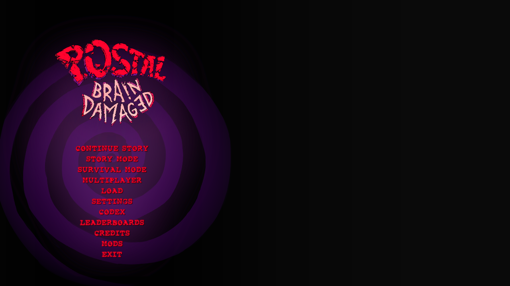

# POSTAL: Brain Damaged Multiplayer (PBDMP)

Play **POSTAL: Brain Damaged** together. PBDMP adds two-player co-op to the campaign, letting you team up with a friend over LAN.

Built for BepInEx 6 IL2CPP. **Current development version: 0.7.0.**

## Sync progress

A quick look at what's ready and what's next. See the [full sync checklist](docs/sync-progress.md) for individual features.

| Feature | Planned | Partially synced | Synced | Comments |
| --- | :---: | :---: | :---: | --- |
| LAN Host / Join | | | ✅ | Connect with a friend. |
| Player movement and aim | | | ✅ | See each other in-game. |
| Player model and animations | | ✅ | | More visual polish planned. |
| Campaign travel and pause | | | ✅ | Play through levels together. |
| Independent respawns | | | ✅ | Keep playing when someone dies. |
| Gunfire, projectiles and combat | | | ✅ | Fight together. |
| NPCs, pedestrians and flying enemies | | | ✅ | Shared enemies and reactions. |
| Doors and shared unlocks | | | ✅ | Either player can interact. |
| Urine interactions | | | ✅ | Shared puzzles and effects. |
| Mission triggers and machinery | | ✅ | | Broader coverage in progress. |
| Joining an active session | | ✅ | | Some world state remains unfinished. |
| Shared checkpoints | ✅ | | | Planned. |
| Multiplayer saves | ✅ | | | Planned. |

**Milestone progress: 81%.** [Score breakdown and intentionally local systems](docs/sync-progress.md#progress-score).



## Installation

No release is available yet while the mod is in development. If you'd like to build it yourself, expand the instructions below.

<details>
<summary>Build and install from source</summary>

You need Windows x64, your own game installation, PowerShell, and **.NET SDK 10** to build from source. The plugin targets .NET 6 for the pinned loader runtime; the supplied network test runner targets .NET 10.

The reference game build uses **Unity 2021.3.14f1**, **IL2CPP metadata 29**, and **BepInEx 6 IL2CPP win-x64**, pinned to `6.0.0-be.788+5b766a3`. Other game builds require compatibility testing. A Mono loader is incompatible with this setup.

### Path placeholders

All paths in these instructions are relative paths or placeholders for the reader's own setup.

| Placeholder | Meaning |
| --- | --- |
| `<RepoDir>` | Your repository checkout. |
| `<GameDir>` | The game folder containing `POSTAL Brain Damaged.exe`. In Steam, use **Manage → Browse local files**. |
| `<Decompiled>` | Optional, independently generated research output from your own game installation. Not included or needed for a normal build. |

### Build and install

Run from PowerShell. Replace `<RepoDir>` with your checkout; enter your game folder when prompted. Skip `Install-Loader.ps1` if a compatible loader is already installed.

```powershell
Set-Location '<RepoDir>'
$GameDir = Read-Host 'Game folder containing POSTAL Brain Damaged.exe'

.\scripts\Install-Loader.ps1 -GameDir $GameDir

Start-Process -FilePath (Join-Path $GameDir 'POSTAL Brain Damaged.exe') -Wait

.\scripts\Build.ps1 -GameDir $GameDir
.\scripts\Install-Plugin.ps1 -GameDir $GameDir
```

The loader installer checks a pinned archive hash and refuses to replace an existing BepInEx installation. The build reads generated assemblies from `<GameDir>/BepInEx/interop`; recovered dummy/decompiler DLLs cannot replace them.

`Build.ps1` builds the plugin, runs network acceptance tests and places the plugin package in `artifacts/PBDMP`. Install **both** `PBDMP.dll` and `PBDMP.Network.dll` together; the installer handles this. Game binaries, extracted assets, generated interop and loader binaries are not supplied by this repository.

Always pass `-GameDir` to build/install/runtime-test scripts. Their legacy default expects a sibling `Game` folder and is not automatic Steam discovery. Rollback manifests and backups are stored in the checkout's ignored `.local` directory; keep the checkout used for installation until uninstall is complete.

### Play together

Launch the game normally on both PCs after installation.

Find P1's LAN IPv4 address in PowerShell:

```powershell
ipconfig
```

1. P1 opens **Multiplayer**, chooses a port (default `7777`) and selects **Host (P1)**.
2. P2 enters P1's IPv4 address and port, then selects **Join (P2)**. `127.0.0.1` only reaches the same PC. Allow the game/TCP port on your private LAN if Windows Firewall prompts.
3. P1 starts a built-in campaign level, or hosts an already active one. P2 loads the same map and receives the supported current world state before play resumes.
4. Use the pause-menu entry or **F8** for connection status and disconnect. P1 controls difficulty, starts, restarts and level changes. Walk-in exits require both living players at the exit; interactable endings require both nearby. Automatic endings wait until both are alive and loaded.

P2 joins in clear space near P1, with normal-map-spawn fallback. P1's weapons and ammo are copied once on joining; health, armor, keys and powerups are not copied. Later inventories stay independent.

Death respawns only that player after three seconds at the map spawn with full health, zero armor, retained gear/ammo/items and cleared temporary powerups. P1's pause stops the timer. P2 opening a menu does not pause P1. P2 leaving lets P1 continue; P1 leaving ends the session and returns P2 to the main menu.

### Development and testing

From `<RepoDir>`, with `$GameDir` set as above:

```powershell
.\scripts\Build.ps1 -GameDir $GameDir

.\scripts\Test-Runtime.ps1 -GameDir $GameDir
.\scripts\Test-Travel.ps1 -GameDir $GameDir

.\scripts\Test-Travel.ps1 -GameDir $GameDir -Combat
.\scripts\Test-Travel.ps1 -GameDir $GameDir -Mission
.\scripts\Test-Travel.ps1 -GameDir $GameDir -MissionExits -Level LEVEL_AD_Prison
```

`Build.ps1 -SkipTests` skips network tests. Runtime scripts launch owned game processes and block profile writes through diagnostic flags. Most test windows are hidden; `-FocusInput` intentionally exercises window focus. Two-instance travel tests use local hardlinks/junctions and retain ignored diagnostic output. See [verification](docs/verification.md) for prerequisites, additional modes and evidence limits.

Source layout: `src/PBDMP.Network` contains the bounded TCP protocol/session; `src/PBDMP.Plugin` contains Unity/BepInEx adapters; `tests/PBDMP.Network.Tests` contains executable network scenarios. Start with the [documentation index](docs/README.md) and [contributor guidance](docs/contributing.md). Keep Unity calls on Unity's main thread.

### Uninstall

Close the game and run these from the same checkout used to install it. Run the loader command only if that checkout also installed the loader:

```powershell
.\scripts\Uninstall-Plugin.ps1
.\scripts\Uninstall-Loader.ps1
```

Uninstall uses recorded manifests, preserves original backups and refuses to overwrite files whose hashes changed. Config, logs and generated interop remain available. Do not copy machine-specific install manifests into Git.

</details>

## Documentation

Browse the [documentation](docs/README.md), [roadmap](docs/roadmap.md) or [contributor guide](docs/contributing.md).

## License

PBDMP's original source and documentation are licensed under the [MIT License](LICENSE), copyright 2026 macery12. Game content, illustrative game renders and third-party components retain their respective owners' rights. The mod resolves native models, UI, sounds and effects from each player's own game installation at runtime.
